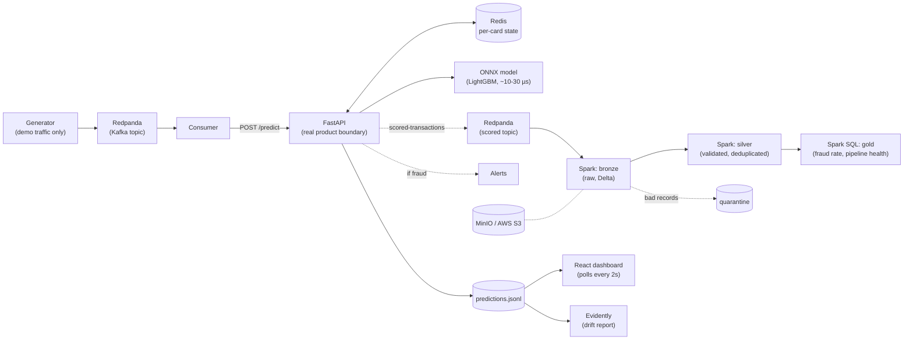

# Real-Time Fraud Detection Pipeline

[](https://github.com/erbolboribaev/fraud-detection/actions)


A real-time credit-card fraud detection system: synthetic transactions stream through Kafka, get scored by a LightGBM model (served as ONNX, ~10-30 µs model inference), and flagged transactions trigger alerts -- all observable through a live React dashboard with SHAP explanations and data-drift monitoring.

Built end-to-end: data generation, feature engineering, model training, low-latency serving, streaming, monitoring, a feedback loop for retraining, and three deployment targets (Docker Compose, Kubernetes, CI/CD).

## Demo


Run it yourself in one command -- see [Quickstart](#quickstart) below.

## What it does

1. A synthetic transaction generator streams card transactions through Kafka (Redpanda), including realistic fraud bursts (stolen-card patterns: rapid, high-value, cross-border purchases in risky categories).
2. A consumer forwards each transaction to a FastAPI `/predict` endpoint, which is the real product boundary -- it doesn't know or care whether the caller is the demo generator or a real payment processor.
3. The endpoint computes 8 features from Redis-backed per-card history (amount ratio vs. the card's average, time since last transaction, velocity in the last 10 minutes, etc.), scores them with an ONNX-exported LightGBM model, and returns a fraud probability.
4. Flagged transactions trigger an alert (console + file, optionally Slack) and are explained via SHAP (which features pushed the score up or down, and by how much).
5. Every scored transaction is logged and compared against the training distribution (Evidently AI) to catch data drift before it silently degrades accuracy.
6. A `/feedback` endpoint lets a human confirm or correct a prediction, closing the loop for future retraining.

## Architecture



The box most people get wrong: **the generator/Redpanda/consumer path exists only for this demo.** A real payment processor would call `POST /predict` directly -- nothing downstream of that line would need to change.

## Lakehouse layer (Spark + Delta on S3)

Besides serving, every scored transaction is published to a second Kafka topic (`scored-transactions`) and lands in a small lakehouse built with Spark Structured Streaming and Delta Lake. This replaces `predictions.jsonl` as the *analytical* store; the dashboard still reads the flat file, so the hot path is unchanged.

| Layer | Job | What it holds |
| ----- | --- | ------------- |
| **Bronze** | `lakehouse/jobs/bronze.py` (streaming) | Kafka records exactly as received (raw JSON + topic/partition/offset), partitioned by ingest date. Never fails on a bad payload. |
| **Silver** | `lakehouse/jobs/silver.py` (streaming) | Parsed, typed, validated, deduplicated by `transaction_id` via Delta `MERGE`. Invalid records go to a **quarantine** table with a `reject_reason`. |
| **Gold** | `lakehouse/jobs/gold.py` (batch, Spark SQL) | `fraud_hourly` (flagged rate by hour, category, country) and `pipeline_health_hourly` (accepted vs rejected records). |

Design points:

- **Idempotent by construction.** Kafka and the API's publisher are at-least-once, so silver uses `MERGE ... WHEN NOT MATCHED THEN INSERT`: a transaction is stored once however many times it arrives. Same idea as the Redis `SETNX` guard on the serving side.
- **Publishing can never hurt scoring.** It is opt-in (`KAFKA_BOOTSTRAP`), asynchronous, and wrapped in a short circuit breaker; dropped events are counted and shown in `/health`. The cost is at-most-once delivery *from the API*, which is acceptable for analytics and would not be for the scoring path.
- **One contract.** `src/events.py` defines the event once; the Spark schema is derived from it, and a test pushes an API-built event through the lake's parser.
- **Bad data is kept, not dropped.** Bronze stores raw bytes; silver quarantines with a reason, so a producer changing its payload shows up as a rising `reject_rate` instead of missing rows.
- **S3-ready.** Jobs only see an `s3a://` path. Locally that is MinIO; for AWS S3, change `LAKE_ROOT`, drop `S3_ENDPOINT`, and use an IAM role. *This repo has only been run against MinIO, not AWS.*

Run it (after `docker compose up --build -d`):

```bash
docker compose run --rm lakehouse-gold     # build the gold tables from silver
# browse the lake files in the MinIO console: http://localhost:9001 (minioadmin / minioadmin)
```

## Results

> **Note:** the model is trained and evaluated on **synthetic, rule-generated data**. These numbers show how well it learned those fraud patterns, not how it would perform on real transactions.

| Metric                                           | Value                                       |
| ------------------------------------------------ | ------------------------------------------- |
| Test ROC-AUC                                     | 0.987                                       |
| Test PR-AUC                                      | 0.945                                       |
| Precision / Recall @ threshold                   | 0.947 / 0.868                               |
| Model inference latency (ONNX, single transaction) | ~10-30 µs                                 |
| Model inference latency (raw LightGBM, for comparison) | ~400-800 µs (~30x slower)             |
| Top features by SHAP impact                      | `amount_ratio` (47%), `category_code` (21%) |
| Tests                                            | pytest + CI: core, event contract, Spark transforms |

Latency above is model inference only; the full `/predict` request additionally includes HTTP handling and Redis reads/writes.

## Tech stack

| Layer               | Choice                                            |
| ------------------- | ------------------------------------------------- |
| Streaming           | Kafka (Redpanda)                                  |
| Feature engineering | Polars                                            |
| Model               | LightGBM, exported to ONNX for serving            |
| Serving             | FastAPI + Redis (per-card state)                  |
| Explainability      | SHAP (TreeExplainer on the native LightGBM model) |
| Drift monitoring    | Evidently AI                                      |
| Lakehouse           | Spark Structured Streaming, Delta Lake, Spark SQL |
| Object storage      | MinIO locally (S3-compatible); AWS S3-ready       |
| Frontend            | React + Vite                                      |
| Deployment          | Docker Compose, Kubernetes (manifests included)   |
| CI/CD               | GitHub Actions (tests + Docker image builds)      |

## Quickstart

```bash
git clone https://github.com/erbolboribaev/fraud-detection.git
cd fraud-detection
docker compose up --build -d
cd frontend && npm install && npm run dev
```

Open `http://localhost:5173` for the dashboard, `http://localhost:8000/docs` for the API, `http://localhost:8080` for Redpanda Console.

## Project structure

```
fraud-detection/
├── src/
│   ├── data_generator.py       # synthetic transaction stream (Kafka producer)
│   ├── feature_engineering.py  # batch feature computation (training)
│   ├── schema.py               # shared constants (no Polars dependency)
│   ├── predictor.py            # online feature computation + ONNX inference
│   ├── train.py                # LightGBM training, ONNX + native export
│   ├── consumer.py             # Kafka -> API bridge
│   ├── events.py               # scored-transaction event contract (shared with the lake)
│   ├── publisher.py            # best-effort Kafka publisher used by the API
│   ├── alerts.py               # fraud alert delivery (file/console/Slack)
│   ├── drift_report.py         # Evidently drift report
│   ├── explain.py              # standalone SHAP CLI
│   └── apply_feedback.py       # joins feedback into a retraining dataset
├── lakehouse/                  # Spark jobs: bronze.py, silver.py, gold.py + pure transforms
├── api/main.py                 # FastAPI app: /predict, /feedback, dashboard reads
├── frontend/                   # React + Vite dashboard
├── models/                     # trained model artifacts (ONNX + native LightGBM)
├── docker/                     # Dockerfile.api (lean), Dockerfile.stream, Dockerfile.lakehouse
├── k8s/                        # Kubernetes manifests
├── tests/                      # pytest suite
├── docs/                       # screenshots
├── docker-compose.yml
├── requirements.txt            # requirements-api / -stream / -lakehouse .txt per image
└── .github/workflows/ci.yml
```

## Technical decisions

**ONNX for serving, not the raw LightGBM model.** ~30x faster single-row inference (µs instead of hundreds of µs), which matters because `/predict` is in the hot path of every transaction. The native LightGBM model is still saved alongside it (`models/fraud_model.txt`) purely because SHAP's `TreeExplainer` needs the real tree structure -- `onnxruntime` sessions don't expose it. Two artifacts, two purposes: ONNX for the latency-critical path, native for the offline explainability path.

**Time-based train/val/test split, not random.** A random split lets the model implicitly see "future" transactions during training, which never happens in production -- you always predict forward from the past. Random splitting would have overstated accuracy.

**Class weights (`scale_pos_weight`), not SMOTE.** Several features here are counts or categorical codes (`txn_count_10m`, `category_code`); SMOTE's synthetic interpolation between minority-class points produces nonsensical values for them (e.g. `category_code = 5.4`). Class weighting penalizes the loss function instead of fabricating data, which keeps every training example real.

**Redis for per-card state, not a database.** Each feature (amount ratio, time since last transaction, 10-minute velocity) only needs a small, fast-expiring window of state per card. Redis gives sub-millisecond reads/writes for exactly that access pattern; a relational database would add latency the hot path can't afford.

**An idempotency guard on every state write.** Kafka guarantees *at-least-once* delivery -- after a consumer restart before offsets are committed, the same transaction can be redelivered. Without a guard, the duplicate would double-count itself into the card's own history (e.g. `amount_ratio` computed against itself). Fixed with a Redis `SETNX` keyed on `transaction_id`: harmless to re-score, but only ever counted once.

**`src/schema.py` split out from `feature_engineering.py`.** The API's Docker image doesn't need Polars/DuckDB at all -- but `predictor.py` originally imported shared constants from a module that did `import polars` at the top. Moving those constants into a dependency-free module kept the serving image lean without duplicating the category map by hand.

**`initContainers` in the Kubernetes manifests, not `depends_on`.** Docker Compose's `depends_on: condition: service_healthy` has no equivalent in vanilla Kubernetes -- there's no built-in "wait for this other pod to be ready" primitive. Each dependent Deployment runs a small `initContainer` that polls the dependency's port before the main container starts, which is the standard idiom for this.

## Bugs found during development

These were found by running the system end to end and noticing the output didn't make sense.

1. **Training-serving skew from a silent Polars truncation.** `dt.total_seconds()` truncated to whole seconds in the installed Polars version, so the model trained on `secs_since_last` values rounded to the nearest second, while the online predictor computed the same feature with full microsecond precision. Fixed by going through `dt.total_microseconds() / 1_000_000` instead, and verified by asserting batch and online feature computation match exactly (`tests/test_pipeline.py`).

2. **A timezone bug that only showed up at 20:00 UTC.** FastAPI parsed incoming ISO timestamps (no `Z` suffix) as naive datetimes; Python's `.timestamp()` then interpreted a naive datetime as the *server's local time zone* rather than UTC, silently shifting the `hour` feature by exactly the server's UTC offset. Caught by comparing a transaction's logged hour against its raw timestamp and noticing they didn't match -- fixed by explicitly attaching `tzinfo=UTC` before conversion, with a regression test run under `TZ=Asia/Tashkent` to prove it.

3. **Kafka redelivery corrupting Redis state.** After a consumer restart, a batch of already-processed messages replayed from the last *committed* (not last *processed*) offset. Each replayed message updated Redis again, making a transaction look like its own preceding transaction (`amount_ratio` computed against itself, `secs_since_last = 0`). Fixed with the idempotency guard described above, plus switching the consumer to manual offset commits.

## Limitations / what would break at 100x scale

- **`logs/predictions.jsonl` is still a flat file, re-read on every dashboard request.** The lakehouse now holds the analytical copy, but the dashboard has not been moved onto it; at real throughput it would read a serving store (or gold tables) instead of scanning a growing file.
- **The lakehouse has only been run on a laptop-sized stack.** MinIO instead of AWS S3, one Kafka partition, one Spark executor, and gold is a full rebuild rather than incremental. There is no table compaction/`OPTIMIZE`, schema-evolution policy or retention yet.
- **Feed from the API is at-most-once.** If Kafka is down, events are dropped (and counted). The silver layer prevents duplicates but cannot recover events the API never sent; a transactional outbox or publishing from the consumer would close that gap.
- **Single Redis instance is a single point of failure.** Production would need Redis Cluster or a managed equivalent with replication.
- **The model is trained entirely on synthetic data.** The fraud patterns are rule-generated, so the reported metrics describe how well the model learned those rules -- not how it would perform on real transaction data.
- **No authentication on the API.** `/predict` and `/feedback` are open; a real deployment needs request signing or mTLS between the payment processor and this service.

## Testing

```bash
pytest tests/ -v
```

Core tests cover feature-engineering correctness, training/serving parity, idempotency under simulated Kafka redelivery, the timezone fix (run under a non-UTC `TZ`), and the event contract/publisher.

Spark transformations (parsing, validation/quarantine, dedup, gold SQL) have their own tests and CI job; they need Java and `pip install -r requirements-lakehouse.txt`:

```bash
python -m pytest tests/lakehouse -v
```

## License

MIT
